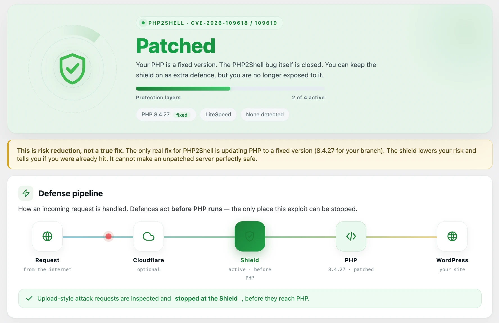
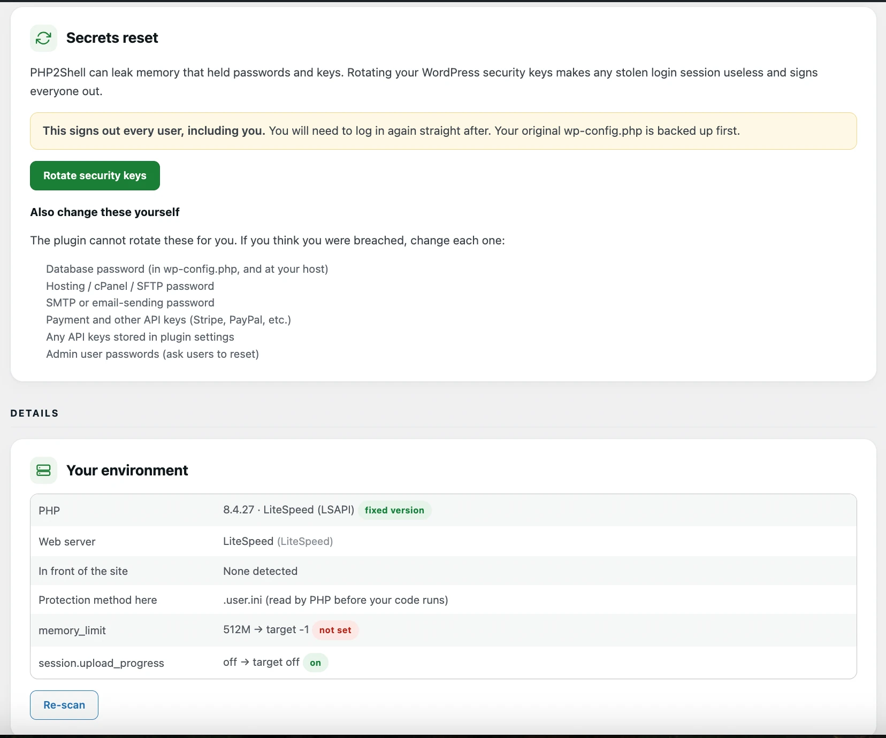
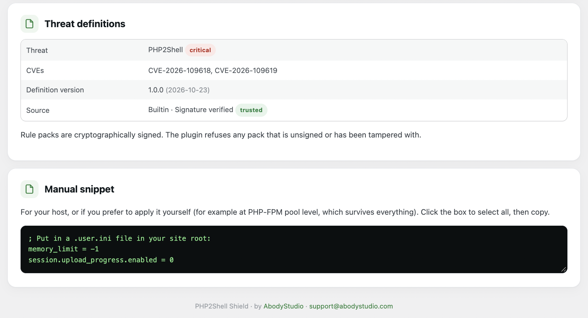

<p align="center">
  
</p>

<h1 align="center">PHP2Shell Shield</h1>

<p align="center">
  <strong>WordPress Security Plugin</strong><br>
  Block the exploit. Protect your site.
</p>

<p align="center">
  Risk reduction for the <a href="https://www.cisa.gov/news-events/alerts/2026/10/21/critical-vulnerabilities-php-require-immediate-patching">PHP2Shell</a> exploit (CVE-2026-109618 / CVE-2026-109619) on WordPress sites that cannot update PHP yet.
</p>

<p align="center">
  <a href="https://github.com/AbodyStudio/php2shell-shield/releases/latest"></a>&nbsp;
  <a href="mailto:support@abodystudio.com"></a>&nbsp;
  <a href="https://abodystudio.com"></a>
</p>

<p align="center">
  <a href="https://github.com/AbodyStudio/php2shell-shield/releases/latest"></a>
  
  <a href="LICENSE"></a>
  
</p>

---

> **This is a shield, not a cure.** The only real fix for PHP2Shell is updating PHP to a fixed version (8.2.35, 8.3.36, 8.4.27 or 8.5.12). This plugin is for the gap until then — it lowers risk, tells you if you were already hit, and gives you an emergency switch. It cannot make an unpatched server perfectly safe.

<p align="center">
  
  <br><sub>The dashboard — live status, a protection-layers meter, and a defense pipeline showing requests stopped before PHP.</sub>
</p>

## In plain English (no jargon)

Think of your website as a **shop**, and **PHP** as the electrical system the whole shop runs on. **PHP2Shell** is a newly-found fault in that wiring: a burglar can use it to sneak in and take over the shop.

The proper fix is replacing the faulty wiring — **updating PHP**. But lots of owners are scared that'll knock over their displays (break their site), so they put it off and stay exposed.

Ordinary security plugins are a guard standing **inside** the shop — but the burglar strikes **in the wiring, before he ever reaches the shop floor**, so the inside guard never sees him. **PHP2Shell Shield is different: it places guards _outside_, at the street and the front door, so the burglar is stopped before he can reach the wiring.** That's the whole trick, and it's why it can protect sites that can't update PHP.

What each part does, in plain terms:

- **The traffic light** — checks your shop and tells you plainly: exposed, protected, or needs your landlord's help.
- **Protection** (one button) — applies the safety settings PHP's own makers recommend, so the burglar's trick stops working. One click, one click to undo.
- **Edge filter / Cloudflare** — a bouncer at the street who turns away the exact kind of suspicious delivery the burglar hides inside.
- **Lockdown** — the "close the shop" button: only you get in; everyone else sees a friendly "back soon" sign.
- **Breach check** — a detective that checks whether a burglar already got in and planted anything.
- **Remote keys** — lists everyone holding a master key to your shop and lets you take a key back.
- **Secrets reset** — changes the locks, so any copied key stops working.

It never pretends the danger is gone — the best it ever says is *"Shielded — still update PHP when you can."* It buys you time and tells you if you've been robbed; it doesn't replace the repair.

## Why a normal plugin can't stop PHP2Shell (technical)

The bug fires while PHP is still reading the request — before WordPress or any plugin loads. So the defences live where the request is handled **before PHP runs**: the edge (Cloudflare), the web server (`.htaccess` / nginx), and PHP's own pre-execution config (`.user.ini`). WordPress is only the control panel.

## Features

Every feature is user-initiated, reversible, and shown plainly — the plugin never claims more safety than it delivers.

### See where you stand
- **Live detection & status** — your PHP version and how PHP runs (FPM / CGI / mod_php / LiteSpeed), the web server, and whether Cloudflare is in front, summed up as one status: **Exposed / Shielded / Patched / Needs host action**.
- **Defense pipeline** — a visual of how a request is handled, showing attacks stopped *before PHP runs*.
- **Protection-layers meter** — how many of your defences are active, at a glance.

### Protect (before PHP runs)
- **One-click shield** — writes PHP's own recommended stopgap settings (`memory_limit=-1`, `session.upload_progress.enabled=0`) to `.user.ini` or `.htaccess`, then **verifies on the next request** that they took effect. Backed up and reversible, with `IfModule` guards so a bad `.htaccess` can't take the site down.
- **Edge request filter** — blocks upload-style requests except on an editable allowlist, applied via `.htaccess`, the **Cloudflare API** (non-destructively — your other rules are untouched), or a generated **nginx** snippet.
- **Lockdown** — the panic button: takes the site offline except your IP, with a maintenance page, blocking at the web server before PHP runs. Instantly reversible.

### Check & recover (assume some sites are already hit)
- **Breach check** — compares WordPress **core and plugin** files against WordPress.org checksums, scans **uploads** for hidden PHP, and lists **admins created recently**. Report-only — it never deletes anything.
- **Remote access key audit** — finds master-key connectors (**UpdraftCentral, ManageWP, MainWP, InfiniteWP, Jetpack**) and lets you cut any of them in one click.
- **Secrets reset** — rotates your WordPress auth keys/salts in `wp-config.php` (so stolen sessions stop working), with a backup and a checklist of what you must change yourself.

### Upgrade PHP — the real fix
- **Compatibility check** — scans your active plugins and theme for code newer PHP *removed* (create_function, each(), mysql_*, …), reads declared `Requires PHP`, and tells you plainly whether you're ready to upgrade — with the exact files and lines if not.
- **One-click PHP switch (cPanel EA4)** — where the PHP version lives in `.htaccess`, switch it with a backup, a loopback check that the site comes up on the new version, and **automatic rollback** if it doesn't. Other hosts get guided MultiPHP Manager steps.

### Built right
- **Signed rule packs** — threat definitions load from an RSA-SHA256-signed pack; unsigned or tampered packs are refused.
- **Signed self-updates** (GitHub build) — updates verify the downloaded zip's signature before installing. (The WordPress.org build updates through WordPress.org instead.)
- **PHP 5.4+ compatible**, atomic and reversible writes, no data sent anywhere except the services listed below.

## Screenshots

<p align="center">
  
  <br><sub>Breach check, secrets reset, and your environment at a glance.</sub>
</p>

<p align="center">
  
  <br><sub>Signed threat definitions, and the copy-paste snippet for your host.</sub>
</p>

## Compatibility

- **WordPress 3.6 → current** — deliberately wide: it installs on very old sites (the ones most likely to still run vulnerable PHP) *and* on the latest WordPress, so new sites stay monitored too. No feature uses an API newer than WordPress 3.6.
- **PHP 5.4+** (the oldest affected PHP version) — verified with PHPCompatibility against `testVersion 5.4-`.
- **Apache / LiteSpeed** — full feature set. **nginx / IIS** — detection + generated snippets. **Cloudflare** — full edge rule via API.

## Install

Download the latest `php2shell-shield-vX.Y.Z.zip` from the releases, then in WordPress: Plugins → Add New → Upload. Or copy the `php2shell-shield` folder into `wp-content/plugins/`.

## Build

```bash
./build.sh   # produces dist/php2shell-shield-vX.Y.Z.zip
```

## Rule packs & signing

Rule packs are signed with a private key that is **never** committed (see [`keys/README.md`](keys/README.md)). The public key ships in `packs/signing-key.pub`.

```bash
./tools/gen-keys.sh                                                  # once, to create the keypair
php tools/sign-pack.php packs/php2shell.pack.json keys/p2s-private.pem
```

## Tests

The comparison/parse/transform logic is covered by standalone PHP tests (run on any PHP ≥ 5.6). The WordPress glue (admin screens, `get_users`, plugin deactivation, live `.htaccess`/`wp-config.php`/Cloudflare writes) should be verified on a throwaway test site.

## Author & support

Built by **[AbodyStudio](https://abodystudio.com)**.

- Website: https://abodystudio.com
- Support: support@abodystudio.com · abodystudio@gmail.com
- Issues & security reports: https://github.com/AbodyStudio/php2shell-shield/issues

## License

GPL-2.0-or-later. See [LICENSE](LICENSE).
