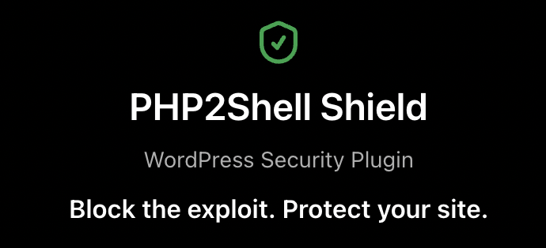

<p align="center">
  
</p>

<p align="center">
  <strong>Risk reduction for the <a href="https://www.cisa.gov/news-events/alerts/2026/10/21/critical-vulnerabilities-php-require-immediate-patching">PHP2Shell</a> exploit (CVE-2026-109618 / CVE-2026-109619) on WordPress sites that cannot update PHP yet.</strong>
</p>

<p align="center">
  <a href="https://github.com/AbodyStudio/php2shell-shield/releases/latest"></a>&nbsp;
  <a href="mailto:support@abodystudio.com"></a>&nbsp;
  <a href="https://abodystudio.com"></a>
</p>

<p align="center">
  <a href="https://github.com/AbodyStudio/php2shell-shield/releases/latest"></a>
  
  <a href="LICENSE"></a>
  
</p>

---

> **This is a shield, not a cure.** The only real fix for PHP2Shell is updating PHP to a fixed version (8.2.35, 8.3.36, 8.4.27 or 8.5.12). This plugin is for the gap until then — it lowers risk, tells you if you were already hit, and gives you an emergency switch. It cannot make an unpatched server perfectly safe.

## Why a normal plugin can't stop PHP2Shell

The bug fires while PHP is still reading the request — before WordPress or any plugin loads. So the defences live where the request is handled **before PHP runs**: the edge (Cloudflare), the web server (`.htaccess` / nginx), and PHP's own pre-execution config (`.user.ini`). WordPress is only the control panel.

## Features

- **Detection** — PHP version, SAPI (FPM/CGI/mod_php/LiteSpeed), web server, Cloudflare; a plain Exposed / Shielded / Patched / Needs-host status.
- **Shield** — writes PHP's recommended stopgap settings (`memory_limit=-1`, `session.upload_progress.enabled=0`) to `.user.ini` or `.htaccess`, verified and reversible.
- **Edge filter** — blocks multipart POSTs except on an allowlist, via `.htaccess`, the Cloudflare API, or a generated nginx snippet.
- **Lockdown** — takes the site offline except your IP, before PHP runs, with a maintenance page.
- **Breach check** — core & plugin checksums vs WordPress.org, uploads PHP scan, recent admins. Report-only.
- **Remote key audit** — detects UpdraftCentral / ManageWP / MainWP / InfiniteWP / Jetpack and lets you cut them.
- **Secrets reset** — rotates WordPress auth keys/salts safely, plus a manual checklist.
- **Signed rule packs** — threat definitions load from an RSA-SHA256-signed pack; unsigned or tampered packs are refused.

## Compatibility

- **PHP 5.4+** (the oldest affected PHP version) — verified with PHPCompatibility against `testVersion 5.4-`.
- **Apache / LiteSpeed** — full feature set. **nginx / IIS** — detection + generated snippets. **Cloudflare** — full edge rule via API.

## Install

Download the latest `php2shell-shield-vX.Y.Z.zip` from the releases, then in WordPress: Plugins → Add New → Upload. Or copy the `php2shell-shield` folder into `wp-content/plugins/`.

## Build

```bash
./build.sh   # produces dist/php2shell-shield-vX.Y.Z.zip
```

## Rule packs & signing

Rule packs are signed with a private key that is **never** committed (see [`keys/README.md`](keys/README.md)). The public key ships in `packs/signing-key.pub`.

```bash
./tools/gen-keys.sh                                                  # once, to create the keypair
php tools/sign-pack.php packs/php2shell.pack.json keys/p2s-private.pem
```

## Tests

The comparison/parse/transform logic is covered by standalone PHP tests (run on any PHP ≥ 5.6). The WordPress glue (admin screens, `get_users`, plugin deactivation, live `.htaccess`/`wp-config.php`/Cloudflare writes) should be verified on a throwaway test site.

## Author & support

Built by **[AbodyStudio](https://abodystudio.com)**.

- Website: https://abodystudio.com
- Support: support@abodystudio.com · abodystudio@gmail.com
- Issues & security reports: https://github.com/AbodyStudio/php2shell-shield/issues

## License

GPL-2.0-or-later. See [LICENSE](LICENSE).
